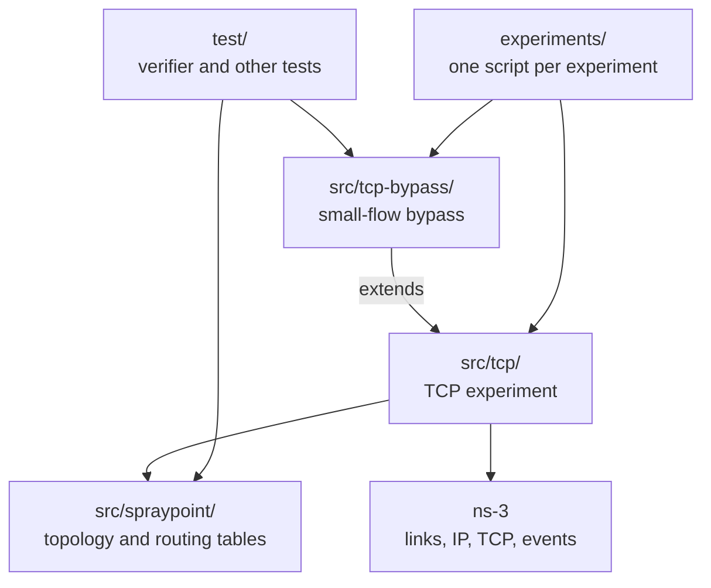
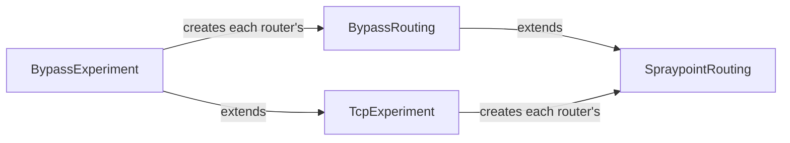
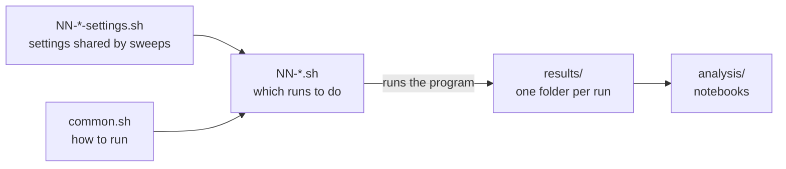

# Architecture

The code is built in layers around one idea: the Spraypoint logic is independent of the simulator, and each experiment adds only what makes it different.

## The layers

- **Spraypoint core (`src/spraypoint/`):** builds the random router graph and the spray and pointing tables. It answers one question, "which neighbor is next?", and knows nothing about packets or ns-3.
- **TCP experiment (`src/tcp/`):** connects the core to ns-3. It builds the network, runs TCP flows over it, and records the results. Routers use the core's tables to forward real packets.
- **TCP bypass (`src/tcp-bypass/`):** the same experiment, except that small flows can skip the spray step. It adds only that routing decision, so flows, TCP, and measurements stay the same as the baseline.
- **Tests (`test/`):** check the layers from outside. The verifier compares the core with the paper, without ns-3, and other tests check the programs' behavior.
- **Experiments (`experiments/`):** each script fixes the settings for one experiment, runs its program, and writes to `experiments/results/<script name>/`.
- **Analysis (`experiments/analysis/`):** notebooks that read `experiments/results/`: one for the baseline, and one comparing it with the bypass.

## Extending the experiment

The TCP experiment has two extension points, and the bypass uses both:

- **`TcpExperiment::CreateRouting`** chooses which routing to put on each router.
- **`SpraypointRouting::SelectNextHop`** chooses a packet's next hop.

A new routing variant can follow the same pattern as a separate program, leaving the existing ones unchanged.

## Experiments

An experiment is a script that says which runs to do. Data moves one way, from scripts to results to notebooks, so analysis can be rerun without rerunning simulations.

- **Scripts (`NN-*.sh`):** each one is a complete, repeatable experiment, numbered in the order to run them and named for what it runs: `smoke` is a quick check, `small-sweep` is a fast sweep on a small network, and `load-sweep` is the larger measurement. To add an experiment, copy a script and change its settings.
- **Shared logic (`common.sh`):** builds the program and runs the simulations, in parallel if asked. It skips finished runs, so an interrupted experiment continues where it stopped.
- **Results (`results/<script name>/<run name>/`):** each run's data, plus the exact options, commit, and machine that produced it. Git ignores the contents.
- **Analysis (`analysis/`):** notebooks that read the results, using whichever runs have finished.
- **Workloads (`workloads/`):** published flow-size distributions that experiments can use.

## Comparing experiments

The same seed and settings give every program the same topology and the same flows, so differences between runs come from the routing. To keep that true, sweeps that will be compared share their settings, as the load sweeps do through `experiments/03-load-sweep-settings.sh`. Compare runs from one platform only, because the same seed can give different flows on Mac and Linux.
