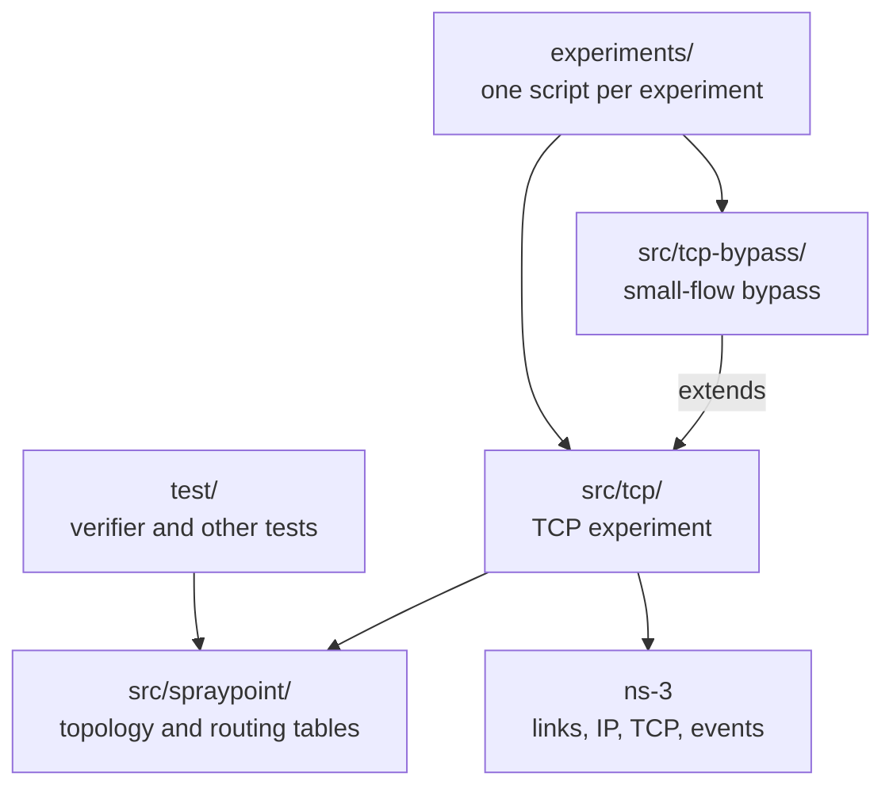

# CSE 561: Shortest-Path Bypass for Small Flows in Spraypoint

This project tests whether routing small flows on shortest paths, instead of spraying them, lowers their tail latency on the fabric from *RNG: Flat Datacenter Networks at Scale*, and what that costs other traffic.

The repository has four programs:

- **Verifier** (`spraypoint-verifier`): checks that the Spraypoint logic is correct, against the paper.
- **Model check** (`bypass-model`): checks the bypass's models on the same routing tables, without simulating packets: path lengths, shortest-path counts, and worst-case throughput as the small flows' share of bytes grows.
- **TCP experiment** (`tcp-experiment`): an ns-3 simulation measuring flow completion times under default Spraypoint.
- **TCP bypass** (`tcp-bypass`): the same simulation with the small-flow bypass on shortest paths between all routers (`--bypass=shortest`). It also supports `--bypass=adjacent`, the direct link between neighboring routers only, which the report sets aside (Section 3) and the experiments no longer run.

**Start with the report, [report/report.pdf](report/report.pdf)**: it explains the project from the beginning, the models, and how to reproduce the results; its appendices cover the simulator's traffic patterns and TCP counters, the workload sweep, and the bypass in a switch pipeline. Rebuild it with `latexmk` in `report/`.

The first CMake configure downloads, builds, and installs the pinned official ns-3 under `third_party/`, which takes several minutes and happens once.

## Structure

The code is built in layers around one idea: the Spraypoint logic is independent of the simulator, and each experiment adds only what makes it different.



- **Spraypoint core (`src/spraypoint/`):** builds the random router graph and the spray and pointing tables. It answers one question, "which neighbor is next?", and knows nothing about packets or ns-3.
- **TCP experiment (`src/tcp/`):** connects the core to ns-3. It builds the network, runs TCP flows over it, and records the results: `traffic-pattern` picks each flow's endpoints, and `tcp-diagnostics` counts each flow's retransmissions and timeouts (report, Appendix B).
- **TCP bypass (`src/tcp-bypass/`):** the same experiment, except that small flows can skip the spray step. It adds only that routing decision, through the two extension points the TCP experiment offers: `TcpExperiment::CreateRouting` picks each router's routing, and `SpraypointRouting::SelectNextHop` picks a packet's next hop. A new routing variant can follow the same pattern as a separate program.
- **Tests (`test/`):** one folder per test. The verifier compares the core with the paper, without ns-3; `bypass-model` checks the bypass's models on the same tables, and its output is experiment data (`05-bypass-model`).
- **Experiments (`experiments/`):** one script per experiment; see below.
- **Analysis (`experiments/analysis/`):** Python scripts that read one batch of results and write tables and figures: `01-baseline.py`, `02-bypass-comparison.py`, `03-model-check.py` (the flow-level check against the permutation sweep) and `04-workloads.py` (the workload sweep), plus the standalone `bootstrap.py` and `workload_cdf.py`.
- **Report (`report/`):** the LaTeX report. `experiments/analysis/report_figures.py` reads pinned batches through the same helpers as the analysis scripts and writes its figures and tables.
- `REPRODUCE.sh` runs every step, from building to the analysis; `REMOTE.sh` runs it on a server over SSH; `cmake/Ns3.cmake` fetches and builds ns-3.

### How experiments run

An experiment is a script that says which runs to do. Data moves one way, from scripts to results to analysis, so analysis can be rerun without rerunning simulations.

- **Scripts (`experiments/NN-*.sh`):** each one is a complete, repeatable experiment, numbered in the order to run them. Sweeps that are compared share a `NN-*-settings.sh`, and each has a `-baseline` and a `-bypass` script that run the same flows. To add an experiment, copy one and change its settings.
- **Shared logic (`experiments/common.sh`):** builds the program and runs the simulations, `JOBS` at a time. It skips finished runs, so an interrupted experiment continues where it stopped.
- **Results (`experiments/results/<machine>/<batch>/<script name>/<run name>/`):** each run's data, with the exact options, commit and machine that produced it. Git ignores them. `<machine>` is `local`, or `remote` for runs from `REMOTE.sh`. A batch is named `<date>_<time>_<code commit>`, where the code commit is the last one to change `src/`, `cmake/`, `CMakeLists.txt`, the numbered experiment scripts, or `test/spraypoint-verifier/` and `test/bypass-model/`. Scripts keep adding to the newest batch for the same code, so a code change starts a new batch and old results never mix with new ones; `NEW_BATCH=1` starts one anyway (`experiments/batch.sh`).
- **Comparing runs:** the same seed and settings give every program the same topology and flows, so differences come from the routing. Compare runs from one batch only: the same seed can give different flows on Mac and Linux, and different code can give different results.

## Experiments

Keep this table in step with the scripts in `experiments/`, which are the source of truth.

| Experiment | Routers | Degree | Hosts per router | Span | Loads | Seeds | Bypass modes | Release delay |
| --- | ---: | ---: | ---: | ---: | --- | --- | --- | ---: |
| `01-smoke` | 64 | 8 | 2 | 1 ms | 0.1, 0.3 with no bypass; 0.3 with a bypass | 561 | none, shortest | 500 µs |
| `02-small-sweep` | 64 | 8 | 2 | 4 ms | 0.1, 0.3, 0.5, 0.7 | 561–565 | none, shortest | 1 ms |
| `03-load-sweep` | 256 | 16 | 4 | 4 ms | 0.1, 0.3, 0.5, 0.7, 0.9 | 561–563 | none, shortest | 1 ms |
| `04-oversubscription` | 256 | 16 | 6, 8 | 4 ms | 0.5 | 561–563 | none, shortest | 1 ms |
| `06-permutation` | 256 | 16 | 4 | 4 ms | 0.1, 0.2, 0.3, 0.4 | 561–563 | none, shortest | 1 ms |
| `07-share-sweep` | 256 | 16 | 4 | 4 ms | 0.5, 0.7 | 561–563 | none, shortest | 1 ms |
| `08-workloads` | 256 | 16 | 4 | 4 ms | 0.3, 0.5, 0.7 | 561–563 | none, shortest | 1 ms |

`06-permutation` uses `--pattern=router-permutation` to send each router's traffic to one partner router. It sweeps small-flow sizes of 10, 27.8 and 47.6 KB, which carry 8.3%, 20% and 30% of the bytes. `07-share-sweep` sweeps the same sizes under uniform traffic.

`05-bypass-model` is not a simulation. It checks the models of the report's Section 5 against the routing tables with `bypass-model`, at 256 routers of degree 16 and 1,000 of degree 64, for seeds 561–563.

All simulations share these settings, with the workload variations described for each sweep:

- **Routing:** 4 waypoints and 2 pointing next hops
- **Links:** 100 Gbps with 500 ns delay
- **Queues:** 100 packets at routers and 1,000 at hosts
- **Traffic:** uniform random hosts, with 90% of flows at 10 KB and 10% at 1 MB, so small flows carry 8.3% of the bytes
- **TCP:** 1 ms minimum retransmission timeout

### Workload sweep (H2)

`08-workloads` tests H2 on workloads with more of the bytes in small flows: more or larger small flows, and the WebSearch and Hadoop flow-size distributions with small-flow cutoffs of 10 KB, 100 KB and 1 MB (report, Appendix C). Its large scenarios need far more memory than the rest, so it runs through its own queue, which admits runs by their estimated memory:

```bash
RESULTS_BATCH=<unique-batch-name> JOBS=8 bash experiments/run-workloads.sh --memory-gb 12
```

`run-workloads.sh` freezes the sources and programs into the batch and runs `experiments/workload-queue.py`, which plans 210 runs (`08-workloads` plus `03-load-sweep`) from the scripts and reruns `04-workloads.py` as they finish, writing to `<batch>/analysis/08-workloads-summary/`. Add `--dry-run` to see the plan and the runs that won't fit the budget. Rerun with the same `RESULTS_BATCH` to resume; finished runs are skipped. The batch's `status` file says `running`, `complete`, `failed`, `stopped` or `blocked-memory` (only runs too large for the budget are left). `./REPRODUCE.sh` includes the sweep with `RUN_WORKLOADS=1`. To run part of it with the ordinary scripts instead, set `EXPERIMENT_SCENARIOS`, `EXPERIMENT_LOADS` or `EXPERIMENT_SEEDS`.

## Workflow

`./REPRODUCE.sh` runs everything below in order, from building to the analysis. The individual steps are:

```bash
cmake -B build                                 # configure
cmake --build build --parallel                 # compile, into build/bin/
ctest --test-dir build -L quick                # fast tests, in seconds
ctest --test-dir build                         # all tests, including the full verifier
experiments/01-smoke-baseline.sh               # quick end-to-end checks, about 10 seconds each
experiments/01-smoke-bypass.sh
JOBS=6 experiments/02-small-sweep-baseline.sh  # small network; JOBS sets how many runs go at once
JOBS=6 experiments/02-small-sweep-bypass.sh    # same flows as the baseline sweep, with each bypass
JOBS=6 experiments/03-load-sweep-baseline.sh   # larger network, using the same pattern
JOBS=6 experiments/03-load-sweep-bypass.sh
JOBS=3 experiments/04-oversubscription-baseline.sh  # busier fabric, same host load
JOBS=3 experiments/04-oversubscription-bypass.sh
JOBS=1 experiments/05-bypass-model.sh           # flow-level model check; each run uses every core
JOBS=6 experiments/06-permutation-baseline.sh  # permutation traffic around saturation
JOBS=6 experiments/06-permutation-bypass.sh
JOBS=4 experiments/07-share-sweep-baseline.sh  # small flows' share of bytes, uniform traffic
JOBS=4 experiments/07-share-sweep-bypass.sh
RESULTS_BATCH=<name> JOBS=8 bash experiments/run-workloads.sh --memory-gb 12  # workload sweep; with RUN_WORKLOADS=1
cmake --build build --target format            # format the C++ code before committing
```

- **Reproduce an experiment:** run its script. It builds what it needs, and rerunning skips finished runs, so an interrupted experiment picks up where it stopped.
- **Analyze results:** run `python3 -m venv experiments/analysis/.venv && experiments/analysis/.venv/bin/pip install -r experiments/analysis/requirements.txt` once, then run a script with that Python: `01-baseline.py` summarizes a sweep's baseline, `02-bypass-comparison.py` compares its bypass runs with the baseline on the same flows, and `03-model-check.py` compares `06-permutation` with the flow-level check in `05-bypass-model`. Each reads whatever runs have finished in the newest batch with its sweep, `03-load-sweep` unless `--sweep` picks another, such as `04-oversubscription` (hosts per router instead of loads) or `06-permutation` and `07-share-sweep` (the small flows' share of bytes and the load). `--results` picks another batch folder (or set `RESULTS_MACHINE` and `RESULTS_BATCH`). Each writes `README.md` with its tables, plus one CSV per table and one PNG per figure, to `<batch>/analysis/<sweep>-<name>/`, or to `--output`.
- **Run on a server:** copy `.env.example` to `.env` and fill in the login, then run `./REMOTE.sh start`. It sends the current commit and runs `./REPRODUCE.sh` there, which keeps going after you disconnect. `./REMOTE.sh status` or `logs` shows its progress, and `./REMOTE.sh fetch` copies the results into `experiments/results/remote/`. The server needs `git`, `cmake`, `make`, a C++ compiler, and `python3` with `venv`, and password logins need `sshpass` locally (`brew install sshpass`).
- **Add an experiment:** copy a script in `experiments/` and change its settings.
- **Add a test:** create `test/<name>/` with a `CMakeLists.txt`, and add it to `test/CMakeLists.txt`.
- **Run with other settings:** pass options to a program in `build/bin/`. `--PrintHelp` lists the options of `tcp-experiment` and `tcp-bypass`, and `--help` lists those of `spraypoint-verifier` and `bypass-model`.

The simulator supports `uniform`, `permutation` (cyclic host-ID shift), `router-permutation` (seeded router partners), `hotspot`, and `incast` traffic. Each run's `flows.csv` records per-flow TCP counters, including data retransmission timeouts and handshake retries, and `links.csv` records each port's load and drops. The report's Appendix B describes both.
